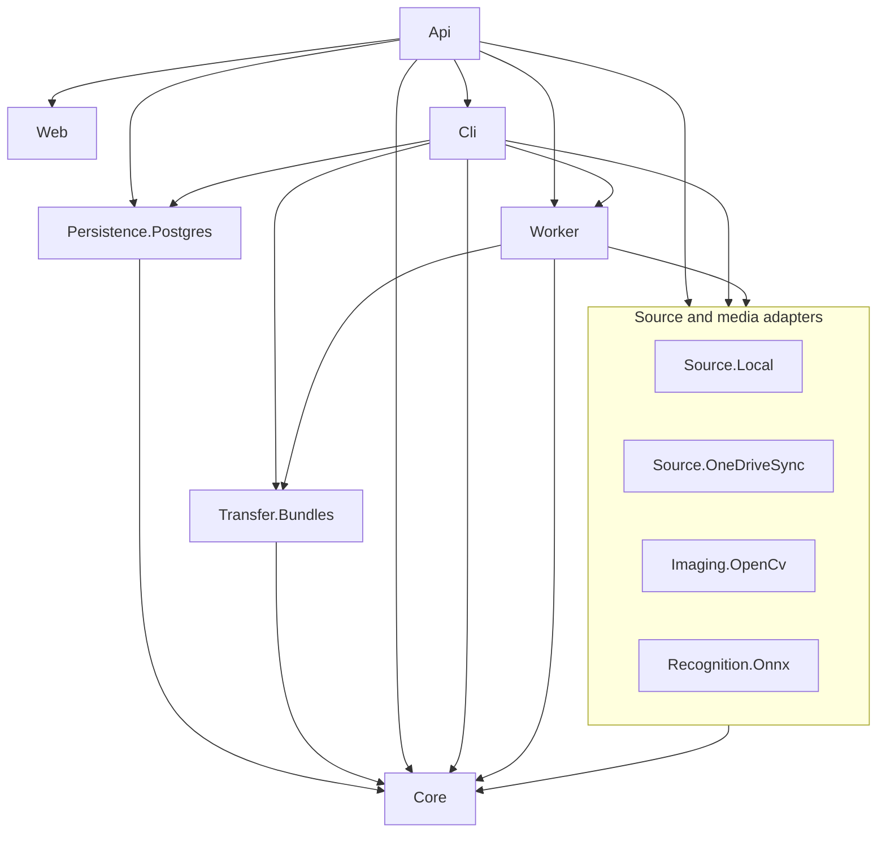

# Architecture overview

Photo Identity Indexer finds people in a private photo and video archive. It is a .NET modular monolith on the
maintainer's Windows computer. PostgreSQL (Podman on WSL2) is the only catalogue. Originals are read-only.

## How a photo moves through the system

1. **Sync:** the archive scan records each content version of a source copy as an immutable revision.
2. **Analyse:** an API background service detects faces and stores crops, embeddings and proxies. Enabled videos follow,
   one at a time, after photos.
3. **Match:** embeddings from one exact model revision rank suggestions and cluster unknown faces.
4. **Review:** the maintainer assigns, rejects or corrects people in the browser. Review history is append-only.
5. **Browse:** collections, search and slideshows prefer derived images over originals.

Captions, semantic search embeddings and place names come from other API background services.

## Modules

An arrow means "references"; an arrow to or from the group applies to all four projects in it. Names omit `PhotoIdentity.`.

| Project | Responsibility |
|---|---|
| `Core` | Identifiers, domain records and adapter interfaces |
| `Persistence.Postgres` | Catalogue schema, queries and writes |
| `Source.*` | File discovery, metadata, OneDrive availability and staging |
| `Imaging.OpenCv` | Decoding, face alignment, crops, thumbnails and proxies |
| `Recognition.Onnx` | Face and semantic models with their preprocessing |
| `Transfer.Bundles` | Checksummed job/result bundles without people or review history |
| `Worker` | Sync, analysis and bundle library; its own executable is a placeholder |
| `Cli` | Operator and evaluation commands; video processing code that `Api` reuses |
| `Api` | Production host: HTTP endpoints, background services, Web client files |
| `Web` | Blazor client and the HTTP contracts shared with `Api` |

## Rules

Project references enforce the first; the rest are conventions.

- `Core` and `Web` reference no other project. Adapters reference only `Core`.
- OpenCV and ONNX types stay inside their adapters. Browser contracts use opaque IDs, never source paths.
- `Worker` reaches the catalogue only through `Core` interfaces; its bundle path uses no catalogue or people data.
- Long batch work belongs in background services, not HTTP requests. C# is the default.

## Data

- **Canonical:** sources, revisions, people, assignments, rejections, review history and run state.
- **Derived (replaceable but sensitive):** detections, crops, embeddings, suggestions and proxies.
- Changed content creates a new revision, so old results are never reused for it.
- A model revision is its ID, SHA-256 and preprocessing. Scores from different revisions are not comparable.
- An assignment links a person to a face, not to a model. Automatic assignment is opt-in, traceable and correctable.

## Trust boundary

Catalogue, people and biometric data stay local by default. The web app has no login: localhost or a trusted private
network only. Data can leave through:

- **Captions:** sent to a loopback address (normally local Ollama); an optional bridge can forward thumbnails to our own
  Azure app ([ADR-0011](../decisions/ADR-0011-operator-authorized-caption-burst-bridge.md)).
- **Place names:** photo coordinates go to GeoNames if a username is configured.
- **Backups:** an optional, operator-requested copy to a OneDrive-synchronised folder.
- **Other remote inference:** separately authorized work only
  ([ADR-0013](../decisions/ADR-0013-optional-operator-controlled-remote-compute.md)).

More: [applications](applications.md), [data model](data-model.md), [matching](identity-matching.md),
[bundles](portable-bundles.md), [privacy](security-and-privacy.md), [decisions](../decisions/README.md), [glossary](../glossary.md).
