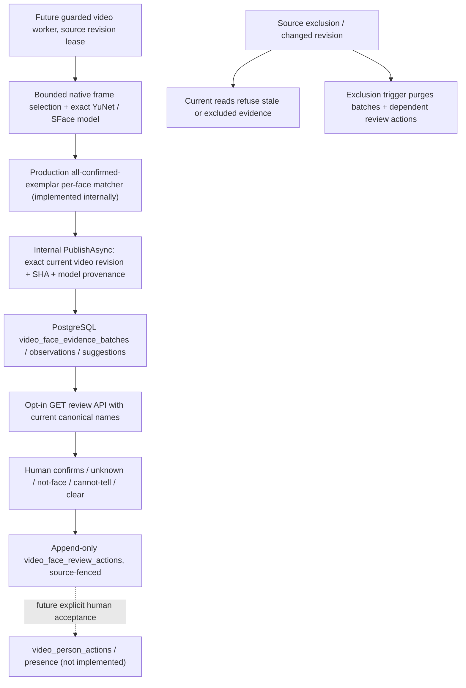

# WI-0155 production video-face review storage and admission

**Status:** PR #828 merged (schema v42); next PR adds production photo-scorer
parity and an internal video score-and-publish bridge. Neither PR enables
a video-face extraction worker or production recognition. Automatic identity
assignment is not authorized. The historical V06 package/CSV remains
private source-bound *experimental* review and is not imported into the
new tables by this PR.

## Data flow and authority



The publication endpoint is **not** exposed over HTTP. The existing bounded
repository contract accepts **geometry, timestamp and ranked person UUIDs**.
The new internal `PostgresVideoFaceMatchPublisher` accepts ephemeral 128D
SFace vectors, scores them through the photo scorer, and forwards only the
ranked leads and geometry to the revision-fenced repository. Neither path
accepts external paths, media uploads, model file paths, or source media. A future guarded worker must prove that
its frame extraction and embedding inputs are from an admitted current
video revision, and use production exemplar scoring before invoking it.

### PostgreSQL schema and invariant summary

- Version 42 creates `video_face_evidence_batches`,
  `video_face_observations`, `video_face_suggestions` and
  `video_face_review_actions`. Foreign keys ensure video-only
  revisions, canonical person records and transactional cascade
  deletion of derived observations.
- One immutable batch per video revision. A SHA-256 fingerprint of the
  exact evidence payload makes retries idempotent and rejects conflicting
  evidence instead of replacing already-reviewed face IDs. Model upgrades
  and intentional reruns require a separately designed versioned
  replacement/retention workflow; this PR does **not** overwrite history.
- The writer takes the source-row lock and validates the revision is
  latest, included, supported, local-folder and byte-digest matched.
  PostgreSQL coordinates exclusion FK locks with that source lock.
  Reads repeat the currentness/exclusion predicate.
- Individual observations have native frame dimensions, normalized
  face boxes, frame ordinal and timestamp. Person suggestions have
  ranked score and canonical person ID; live names are resolved at read
  time and merged people are marked non-selectable. No original video,
  aligned face crop, raw frame, embedding or local file path is stored.
- Human actions are append-only, identified by immutable observation
  UUID, revision and active canonical person; identical repeated
  actions do not append duplicates. `clear` reverses the current
  decision but keeps the audit trail. **Neither a human confirmation
  nor its score writes video-person presence or photo identity.**
- Source-exclusion insertion deletes the batch, which cascades to
  suggestions and review history. New revisions invalidate all
  current-evidence reads for older revisions even before cleanup.

### API routes (both disabled by default)

Enable only with both settings:

```text
PhotoIdentity:VideoLibraryEnabled=true
PhotoIdentity:VideoFaceReviewEnabled=true
```

GET `/api/videos/{revisionId}/face-review` returns only current
published evidence and current canonical person display names.
POST `/api/videos/{revisionId}/face-review/{observationId}/decision`
takes JSON `{"decision":"known","personId":"<canonical UUID>"}`.
Other decisions `unknown`, `not-face`, `cannot-tell` and `clear`
must omit `personId`. The POST returns `{"changed":true|false}`.
The endpoints provide no way to upload evidence or trigger inference.
The feature gate defaults to false. No UI is connected until a guarded
production publisher and private crop renderer have been implemented.

### Safe verification (PowerShell 7.6, disposable PostgreSQL only)

From the repository root on the PR branch:

```powershell
dotnet build src/PhotoIdentity.Persistence.Postgres/PhotoIdentity.Persistence.Postgres.csproj -c Release
dotnet build src/PhotoIdentity.Api/PhotoIdentity.Api.csproj -c Release
# Set ONLY to a disposable PostgreSQL administrator URL for test DB creation:
if (-not $env:PHOTOIDENTITY_TEST_POSTGRES_ADMIN_CONNECTION_STRING) {
    throw 'The isolated PostgreSQL test requires a disposable admin connection.'
}
dotnet test tests/PhotoIdentity.Integration.Tests/PhotoIdentity.Integration.Tests.csproj `
    -c Release --filter FullyQualifiedName~VideoFaceReviewProductionPersistenceTests
```

The test creates and drops its own uniquely named database. It seeds
synthetic video revisions and fake people (never originals/production
catalogue), verifies retry, conflicts, human undo, excluded source
cascade, stale revision and **zero** photo or video-person tagging.
If the admin connection environment variable is unset the test
**skips its body**, so a green test command alone does not prove DB
verification.

**Deployment caution:** an application started against the real
production catalogue will apply migration v42 during initialization
even though face-review routes and inference are disabled. Take and
verify a PostgreSQL backup and inspect the new schema and restoration
plan before deploying or testing this branch against production.
Do not enable the new feature or attempt to import experimental V06
JSON/CSV as production evidence. No new video processing settings or
worker activation is added in this PR.

## Next product integration slices

1. Guarded frame producer integrated into the existing video
   advancement/lease path, with bounds and native face pixel geometry.
2. **Implemented internally:** shared production best-of-all-exemplars
   per-face scoring, strict YuNet/SFace model identity and exact-match
   source-bound PostgreSQL publication. **Remaining:** guarded model inference,
   source-bound private crop access and explicit rights review.
3. Face-review UI backed by these APIs, current people and private
   revision-scoped crop evidence.
4. Explicit human-approved presence promotion to the existing
   `video_person_actions` audit system with deduplication, undo
   and stale-source protection.
5. Operational rights, retention, deletion and observed false-person
   risk acceptance before enabling any background recognition.

## 2026-11-19 — Production photo scorer parity and score-and-publish bridge

The new `PostgresIdentityMatchRegenerationScorer.RankVideoFaceVectorsAsync`
method loads the **identical confirmed-photo exemplar query** used by the
existing photo regeneration worker, in one `REPEATABLE READ, READ ONLY`
snapshot, and calls its **same** maximum-cosine-per-person scoring logic.
There is **no per-person exemplar cap**, group aggregation, exploratory
similarity threshold, automatic identity choice or identity assignment.
The response is a per-observation top-three ranked candidate list, with
canonical person UUIDs, deterministic score/UUID ordering, and full
128-dimensional vector validation. Missing model revisions or inconsistent
confirmed embeddings fail closed. No SFace vectors are persisted.

`PostgresVideoFaceMatchPublisher` turns a batch of bounded
`VideoFaceEmbeddingObservation` records into a v42
`VideoFaceEvidencePublication` using the actual production photo
scorer. The terminal repository checks the current supported unexcluded
video revision and source SHA-256 under the source-row lock *after*
scoring, so a changed source during a long inference cannot publish
stale matches; person merges invalidate conflicting rankings. The
result is an immutable batch with safe retry and zero video/person
assignment writes. The bridge is registered for internal DI only;
there is no route, CLI or scheduled call that invokes it.

**Scope still pending:** frame extraction, native face geometry detector,
aligned SFace embeddings from guarded video source, model file/license
approval, source-attested private crop display, and explicit human
presence promotion. The offline V06 aliases/CSV are not imported into
these production tables.

Run the new isolated PostgreSQL parity acceptance:

```powershell
Set-Location 'C:\Kod\codex\Photo Identity Indexer'
git fetch origin
git switch wi-0155-production-photo-scorer-parity
git pull --ff-only
if (-not $env:PHOTOIDENTITY_TEST_POSTGRES_ADMIN_CONNECTION_STRING) {
    throw 'Configure only a disposable PostgreSQL admin instance for this test.'
}
dotnet test .\tests\PhotoIdentity.Integration.Tests\PhotoIdentity.Integration.Tests.csproj `
    -c Release --filter 'FullyQualifiedName~VideoFaceProductionScorerParityTests'
if ($LASTEXITCODE -ne 0) { throw 'Production SFace scorer parity test failed.' }
```

The disposable test confirms that the fourth exemplar wins when the
first three do not match, that different faces have independent rankings,
the matching model is exact, idempotent publication preserves evidence,
a stale video revision is refused, and no person identity/tag table is
written. It uses only synthetic vectors and synthetic catalogue rows.

## 2026-11-20 — Native-resolution face producer foundation

**PR #831 is merged.** The existing photo matcher now supplies full
confirmed-exemplar rankings for production video observations.

The next isolated native path comprises:
- `VideoFaceNativeFrameProfile`: fixed FFmpeg arguments against an
  already SHA-verified **staged video copy**; frame timing is
  presentation-based, `-autorotate` is enabled, and **no scale, crop,
  pad, upsample or 640-pixel CLIP resize is performed**. JPEGs are
  capped at 12 MiB, decoded BGR24 frames at 3840 pixels per edge.
  Oversized native frames fail closed rather than being silently shrunk.
- `VideoFaceNativeFrameAnalyzer`: the same approved YuNet detector,
  5-point SFace aligner and SFace embedder used by the photo tooling.
  Enforces the exact pinned model digests, 128D vectors, at most
  32 detected faces per frame, native frame geometry and independent
  per-face embeddings; it returns **no person verdicts**.
- `VideoFaceNativeEvidenceProducer`: an **unregistered, explicit-call**
  producer requiring a hypothetical future `FaceEvidence` lease.
  It checks the existing PostgreSQL video control and photo priority,
  stages the current hash-verified local original without recalling
  online-only media, validates supported Rec.709 geometry and duration,
  loads pinned model manifests and validates their files, runs FFmpeg
  in a single-process Windows Job Object, heartbeats the lease, and
  rechecks permission before each frame. It processes 1–4 bounded
  frames and returns an ephemeral proposal with source SHA-256.
  Owned scratch media are cleaned up by the source and process
  supervisors. **No evidence database writes, job completion or
  identity assignments occur from this component.**

**Non-activation rule:** `FaceEvidence` already exists in the v34
queue enum and database constraint, but PR #833 did not add an
operator grant or worker connection for it. Merely deploying that
producer has no inference effect. PR #835 adds the separate selected
grant and lease-fenced commit, still without a CLI, runtime
registration, hosted worker or scheduler. A CLIP `FrameEvidence`
lease cannot authorize face inference. Native face crop rendering,
retention/deletion, model rights and persisted UI remain pending.

**Verification:** no originals, model files or production database are
needed for synthetic acceptance:
```powershell
git fetch origin
git switch wi-0155-native-face-frame-foundation
git pull --ff-only
dotnet test .\tests\PhotoIdentity.Integration.Tests\PhotoIdentity.Integration.Tests.csproj `
    -c Release --filter 'FullyQualifiedName~VideoFaceNativeFrameTests'
if ($LASTEXITCODE -ne 0) { throw 'Native face frame contract failed.' }
```
The test asserts no scaling, native geometry, independent observations,
model digest refusal and candidate overflow failure. Passing synthetic
tests is not evidence of real video detection quality or model rights.

## 2026-11-20 — Dedicated face lease, atomic receipt, and selected-job adapter

**Draft PR #835, migration v43.** `FaceEvidence` was already declared
by the original v34 queue/schema, but previously could not be granted
through `PostgresVideoScopedAttemptControl` and had no publication
transaction or coordinator receipt. This PR connects the existing
components without adding an automatic job scheduler:

1. `VideoFaceEvidenceLeaseIdentity` defines the exact dedicated kind,
   sampling policy, 1–4 frame native extraction preset and pinned
   YuNet/SFace model hashes. A CLIP `FrameEvidence` job cannot use
   the face adapter.
2. The selected-job grant accepts FaceEvidence **only** for the exact
   native preset, one named queued job, an approved FFmpeg SHA-256,
   an accepted frame count and a bounded authorization expiry. No
   generic enable switch authorizes face execution.
3. `VideoFaceEvidenceWorkerAdapter` is **not registered**. If called
   by a separately authorized future command, it monitors heartbeat
   and photo-first interruption through native production, complete
   all-exemplar scoring and the final database commit.
4. `TryPublishLeasedAsync` atomically checks the current unexcluded
   source and source SHA-256, selected control generation/expiry,
   matching live lease token, job identity/bytes/frame count, Rec.709
   inspection, cancellation and photo priority. If any final check
   fails, the batch and any attempted job-success mutation are both
   rolled back. `clock_timestamp()` catches leases/grants that
   expire *during* a longer transaction.
5. Migration **v43** adds nullable `publishing_job_id` to v42 batches.
   Earlier unleased batches retain NULL and **cannot** satisfy a
   different job's durable success receipt. The existing one-job
   coordinator now requires the face batch's exact job ID, current
   source and complete count before accepting a claimed success.
   No SFace vectors, raw frames or paths are stored in PostgreSQL.

**No production activation:** no FaceEvidence endpoint, CLI verb,
enqueue scan, automatic worker registration or background schedule
is provided by this PR. Deploying the code/schema alone cannot start
recognition or mark a person present. The existing video-face review
API stays off by default. The previous unleased internal publication
method remains for compatibility with prior tests and operator
experiments, but it does not produce a job-bound receipt.

**Migration caution:** unlike PR #831/#833, this PR changes the
schema from v42 to v43, and applications may initialize/migrate on
startup. Take and verify a fresh production PostgreSQL backup before
deploying any merged build, inspect migrations first, and keep
face recognition OFF. No V06 CSV import or real video inference
is required to test this PR.

**PowerShell 7.6 acceptance (disposable PostgreSQL ONLY):**
```powershell
Set-Location 'C:\Kod\codex\Photo Identity Indexer'
git fetch origin
git switch wi-0155-face-evidence-lease-fenced-publication
git pull --ff-only
if (-not $env:PHOTOIDENTITY_TEST_POSTGRES_ADMIN_CONNECTION_STRING) {
    throw 'Configure ONLY a disposable PostgreSQL admin instance (not production).'
}
dotnet test .\tests\PhotoIdentity.Integration.Tests\PhotoIdentity.Integration.Tests.csproj `
    -c Release --filter 'FullyQualifiedName~VideoFaceLeasedPublicationTests'
if ($LASTEXITCODE -ne 0) { throw 'FaceEvidence lease publication acceptance failed.' }
```
The test creates and drops its own synthetic database and uses fake
128D vectors instead of video files or ONNX inference. It exercises
selected scope, forged lease rejection, complete atomic publication,
job-specific current receipt and **zero** identity/person assignments.

Remaining pre-activation gates: implement an explicit one-video
operator command with local/rights and source/lease inspection,
review private native face-crop display and retention, connect the
persisted in-app human review, and require manual presence decisions.

## 2026-11-20 — Explicit single-video native face execution (separate PR)

This increment adds the opt-in `video faces selected-one-shot` CLI path.
It operates on **one exact registered video revision UUID**, not an
operator-supplied original filename. It does not create a hosted service,
general enqueue scan, web inference endpoint or automatic person assignments.

**Default is a metadata-only dry run**: requires a current v43 database,
approved FFmpeg file/hash, a newly created empty owned scratch directory,
one supported local-source-authority Rec.709 video inspection at at most
3840 pixels per coded edge and 256 MiB, a reproducible 1–4 frame plan,
no pre-existing face batch for that revision, idle photo work, no
running video jobs, and the global video control disabled/paused.
It does **not** open original video bytes, inspect OneDrive availability,
load local ONNX weights, enqueue, arm control or persist observations.
Output is private-identifier-free JSON with a fixed result code.

`--apply` also requires **both**
`--acknowledge-private-face-processing` and
`--acknowledge-model-rights`. The acknowledgements represent an
operator's *independent* private-media and model-rights review; they
are not technical proof of legal permission. Apply checks local-only
OneDrive availability without hydration or recall, refuses link
paths and scratch/source overlap, enqueues only the chosen exact
revision's `FaceEvidence` identity, arms the existing short-lived
selected grant, runs one bounded `VideoFaceEvidenceWorkerAdapter`
cycle and always attempts to disarm even after cancellation.
The source is staged with SHA-256 verification under the lease;
YuNet/SFace model manifests and model files are SHA-verified inside
the producer; the publisher atomically commits a batch and
job-specific receipt only while the selected grant is live.

**The --apply mode is not yet locally accepted against a genuine
maintainer video.** Until the maintainer has explicitly approved model
rights, the scratch/source-retention policy and one selected local
video, **run only the default dry-run and synthetic tests**. A dry-run
PASS establishes configuration/preflight, *not* recognition quality.
A video containing zero detected faces currently returns
`no-faces-found` without inventing a batch; empty-result treatment
and privacy-safe crop review remain separate work.

### Offline and disposable PostgreSQL verification

```powershell
Set-Location 'C:\Kod\codex\Photo Identity Indexer'
git switch wi-0155-selected-native-face-one-shot-20261120
git pull --ff-only
dotnet test .\tests\PhotoIdentity.Integration.Tests\PhotoIdentity.Integration.Tests.csproj `
    -c Release --filter 'FullyQualifiedName~VideoFaceSelectedOneShotTests'
if ($LASTEXITCODE -ne 0) { throw 'Selected-face CLI tests failed.' }
```

The parser test needs no PostgreSQL. The second test uses a disposable
PostgreSQL instance supplied by
`PHOTOIDENTITY_TEST_POSTGRES_ADMIN_CONNECTION_STRING`; without this
environment variable it returns without exercising the database path.
That test checks metadata-only preview, no queue/grant/face writes,
`--apply` denial for an unavailable original, and source-exclusion
denial. Never configure this integration-test admin variable to point
to `photoidentity_main`.

### Maintainer-selected dry-run (NO source opening)

Only after a controlled trial candidate, tool path and empty scratch
root are selected, create the exact marker required by the existing
scratch ownership guard. The root must be a *new direct child* of OS temp
and must not overlap the source archive:

```powershell
$scratch = Join-Path ([IO.Path]::GetFullPath([IO.Path]::GetTempPath())) `
  ('photoidentity-frame-evidence-wi0155-' + [guid]::NewGuid().ToString('N'))
New-Item -ItemType Directory -Path $scratch | Out-Null
Set-Content -LiteralPath (Join-Path $scratch '.photoidentity-frame-evidence-root') `
  -Value 'wi0190-registered-proxy-frames-v1' -NoNewline

# Supply privately verified values; do NOT share source paths or credentials.
$revisionId = '<CURRENT_REGISTERED_VIDEO_REVISION_UUID>'
$ffmpeg = '<APPROVED_LOCAL_FFMPEG_EXE_ABSOLUTE_PATH>'
$ffmpegSha256 = '<PREVIOUSLY_APPROVED_FFMPEG_SHA256>'
$connectionEnv = '<LAUNCHER_POSTGRES_ENVIRONMENT_VARIABLE_NAME>'

$arguments = @(
  'video','faces','selected-one-shot',
  '--postgres-connection-env',$connectionEnv,
  '--database','photoidentity_main',
  '--revision-id',$revisionId,
  '--scratch-root',$scratch,
  '--ffmpeg',$ffmpeg,'--ffmpeg-sha256',$ffmpegSha256,
  '--manifest-directory',(Join-Path (Get-Location) 'models\manifests'),
  '--model-directory',(Join-Path (Get-Location) 'models\files'),
  '--max-frames','2'
)
dotnet run --project .\src\PhotoIdentity.Cli -c Release -- @arguments
if ($LASTEXITCODE -ne 0) { throw 'Selected face dry-run refused; inspect fixed reasonCode.' }
```

Expected `dryRun=true`, `admitted=true`,
`reasonCode="preflight-only"`, `published=false`,
`oneDriveHydrationRequested=false`, and
`identityAssignmentsMade=0`. The preview deliberately does not
confirm that originals are present locally or that native models
are legally approved; actual execution requires separate gates.

**No migration is introduced by this increment.** The established
v43 production schema remains the prerequisite; no database
initialization is invoked by this CLI command. The normal
photo-archive experience is unchanged.

## 2026-11-20 — Bounded zero-detection receipts (v45, separate PR)

A completed, authorized 1–4-frame native sample with **zero** YuNet face
detections is a legitimate result, not an extraction failure. Previously the
selected worker returned `no-faces-found` without a batch or job receipt,
leaving that revision eligible for another expensive run.

This increment creates **migration v45**, changing only the face-batch
`observation_count` constraint from 1–256 to 0–256. The producer now
returns an empty, source-SHA-attested proposal *only after* all sampled
frames were decoded and analyzed with approved local models while the
selected lease remained valid. The selected publisher skips scoring an
empty vector set and atomically commits a zero-observation batch and the
exact job-success receipt under the existing source, exclusion, lease,
operator-grant and photo-priority locks. The unleased publication API
still rejects an empty result; malformed or incomplete extraction does
not become an empty success.

The CLI reports `no-faces-in-sampled-frames` and
`sampledFaceObservations: 0` only when the current persisted batch confirms
zero rows. This does **not** establish that a video contains no people or
that every face was detected. No video-person presence, photo identity,
face crops, frames, model embeddings, paths or automatic identity choices
are stored. The GET face-review endpoint returns an empty observation list
for the successful sample; it must not be interpreted as full coverage.

**Local verification (PowerShell 7.6, disposable PostgreSQL only):**

```powershell
git fetch origin
gh pr checkout <PR number>
if (-not $env:PHOTOIDENTITY_TEST_POSTGRES_ADMIN_CONNECTION_STRING) {
    throw 'Configure only a disposable PostgreSQL administrator connection.'
}
dotnet test .\tests\PhotoIdentity.Integration.Tests\PhotoIdentity.Integration.Tests.csproj `
    -c Release --filter 'FullyQualifiedName~VideoFaceLeasedPublicationTests'
if ($LASTEXITCODE -ne 0) { throw 'WI-0155 empty-receipt test failed.' }
```

The synthetic test exercises empty and nonempty selected jobs, forged-lease
rejection, unleased-empty refusal, durable success, no person assignments,
and source exclusion purging the zero-result receipt. It reads no
real videos or model files and needs no private data. A green test without
the disposable administrator environment variable **is a skip**, not a pass.

**Production migration gate:** v45 runs during API/CLI catalogue
initialization. Back up and verify `photoidentity_main` before deploying
any build carrying v45; first rehearse the upgrade on a disposable restore.
Keep recognition and review routes disabled by default. There is no new
scheduler, source recall, private crop renderer, manual presence promotion,
model-rights approval or retention sign-off. Do not run real-media
`--apply` without the separately documented maintainer permissions.

## 2026-11-20 — Current-revision face review UI (separate opt-in PR)

The in-app `/videos/{revisionId}/faces` page now consumes the **existing**
production `GET /api/videos/{revisionId}/face-review` and per-observation
`POST .../decision` endpoints. Video Details offers the link only after
a current evidence GET succeeds; the whole feature remains hidden when either
`PhotoIdentity:VideoLibraryEnabled` or
`PhotoIdentity:VideoFaceReviewEnabled` is false. No new schema migration,
scheduled worker, inference endpoint, automatic identity assignment, or
photo identity writer is introduced.

The page shows each detector observation's frame timestamp and native face
geometry, ranked canonical suggestions as individual confirmation buttons,
a search across current canonical people, and unknown/not-face/cannot-tell/
clear decisions. Decisions are sent to the existing append-only, source-
revision-locked repository and reloaded from the server. Reviewed observations
are hidden by default and can be revealed for correction. The visible summary
deduplicates confirmed *people* across repeated observations, not faces,
and explicitly distinguishes a zero-detection sample from video-wide
absence. Conflicts, stale revisions, exclusions and disabled routes withdraw
all actionable observations pending a fresh GET.

**Visual evidence limitation:** This slice uses the already registered,
local, revision-gated **playable proxy**, not a retained source-original
frame or private full-resolution face crop. The proxy opens only when the
operator clicks a sampled observation, and the browser seeks near its
timestamp without autoplay. A reviewer must acknowledge actually inspecting
the visual context before a decision button is enabled. Playback errors
disable decisions. Proxy timestamps and rotation/resolution may differ from
native YuNet/SFace sampling; do **not** treat this as source-verified crop
parity or an acceptance test of recognition quality. The browser does not
capture, export, upload or persist pixels, and no original is opened by
this page. An exact source-attested private crop route remains a separate
required step before treating face review as fully production-ready.

**UI scope:** Existing review decisions still do **not** create or remove
`video_person_actions`. Manual video presence is managed separately in
Video Details; explicit human-approved evidence-to-presence promotion,
deduplication and undo remain future work. Existing imported V06 gallery
and CSV workflows remain available but are not silently imported into
the production batch. The safe default is to keep video face review disabled
until real-media model rights, visual quality and retention have been approved.

**PowerShell 7.6 verification, no real media or database required:**

```powershell
Set-Location 'C:\Kod\codex\Photo Identity Indexer'
git fetch origin
gh pr checkout <this PR number>
dotnet build .\src\PhotoIdentity.Web\PhotoIdentity.Web.csproj -c Release
if ($LASTEXITCODE -ne 0) { throw 'Face review UI build failed.' }
dotnet test .\tests\PhotoIdentity.Integration.Tests\PhotoIdentity.Integration.Tests.csproj `
    -c Release --filter 'FullyQualifiedName~VideoFacePersistedReviewWebContractTests'
if ($LASTEXITCODE -ne 0) { throw 'Face review UI contract test failed.' }
```

Optional interactive acceptance requires a **previously authorized** current
leased FaceEvidence batch, its exact revision with a playable proxy, and
both settings enabled on a private local host. In Video Details, follow
"Review sampled faces"; select an observation, inspect/seek the proxy,
acknowledge context, choose one suggested/canonical person or an uncertain
decision, confirm it hides, reopen it, and clear it. Verify a stale/excluded
revision no longer loads decisions. Check that the video person's manual tags
and photo identities are unchanged. Do not run new real-media inference
solely to populate the UI; source-backed native crop and rights approval
remain outstanding.

## 2026-11-20 — Source-attested native face crop delivery (separate opt-in PR)

**Purpose:** remove the #849 persisted-review UI's reliance on a proxy-only
visual cue without re-running a face-discovery experiment, storing images,
or linking reviewed identities to video-person presence. Source-backed crops
are produced **only** when a human explicitly opens a current persisted
FaceEvidence observation and an additional operator configuration gate is
on. The imported V06 package remains a separate, offline workflow.

### Authority, scope and privacy

1. The extra gate `PhotoIdentity:VideoFaceNativeCropEnabled=true` is required
   **in addition** to `VideoLibraryEnabled` and `VideoFaceReviewEnabled`.
   All default to off. The new read-only
   `GET /api/videos/{revisionId}/face-review/{observationId}/native-crop`
   returns 404 if a gate, observation, source proof, model version, tool
   digest or local source requirement is absent. No arbitrary paths,
   coordinates, video timestamps or media data are accepted from the client.
2. The PostgreSQL reader locks the source **and asset** before querying current
   eligibility. It requires the newest included Rec.709 local video revision,
   a SHA-matching v45 face batch, an exact successful **leased** FaceEvidence
   job (not legacy unleased evidence), the pinned detector/SFace/alignment
   metadata, and the same approved FFmpeg SHA as the publishing job.
   Frame ordinal and millisecond timestamp must match the deterministic
   original 1–4-frame interval plan. These checks are read-only and run
   against current canonical catalogue evidence. Source/asset locks are
   held until the response is sent, fencing exclusions and newer revisions.
3. A local-only, no-recall source reader refuses unavailable/online-only
   originals and link paths. It SHA-256-verifies at most 256 MiB while staging
   into a dedicated owner-marked scratch directory, never allowing FFmpeg
   to open an original directly. FFmpeg runs in a bounded Windows Job Object
   with the same autorotated, native-size, no-resize frame profile used
   by the producer. The decoded frame dimensions **must equal** the original
   observation's geometry.
4. The server crops only the immutable detector box with modest native-pixel
   context, JPEG-encodes at most 2 MiB, and sends bytes with
   `Cache-Control: private, no-store, max-age=0` and no range support.
   Pixels are never written to the application catalogue, a retained crop
   cache or browser storage. The FFmpeg native-size frame intermediate\n   and resulting crop both use **lossy JPEG encoding**: no resizing is\n   performed, but source pixels are not losslessly reproduced. Staged\n   media and FFmpeg scratch are discarded
   after each request. A failed deletion preserves the owned workspace
   for controlled cleanup rather than deleting arbitrary files. The UI
   displays the crop at natural dimensions **without upscaling**.
5. In the #849 review page, an explicitly inspected crop can unlock the
   existing human-decision buttons after the reviewer checks the visual
   acknowledgement. If native crop is disabled or unavailable, the
   previously available proxy remains a clearly labelled fallback. The
   proxy may represent a nearby frame, so its presence does not establish
   native sampling fidelity.

**No activation:** No new worker, scheduler, selected-face job grant,
ONNX inference, hydration, database migration, automatic identity
assignment, video-person action or photo identity edit is provided.
The native crop pathway uses original bytes on explicit request; keep it
disabled until the original-media handling, model/tool usage rights and
local scratch policy have been independently accepted.

### Synthetic acceptance (safe now)

From PowerShell 7.6, on this PR branch:

```powershell
dotnet build .\src\PhotoIdentity.Api\PhotoIdentity.Api.csproj -c Release
if ($LASTEXITCODE -ne 0) { throw 'WI-0155 native crop API build failed.' }
dotnet test .\tests\PhotoIdentity.Integration.Tests\PhotoIdentity.Integration.Tests.csproj `
    -c Release --filter 'FullyQualifiedName~VideoFaceNativeCropReviewTests'
if ($LASTEXITCODE -ne 0) { throw 'Native crop/guard tests failed.' }
```

The synthetic contract tests check box arithmetic, native-size JPEG dimensions,
scratch ownership and web gating without any media, model, database or FFmpeg.
CI also runs the existing disposable PostgreSQL
`VideoFaceLeasedPublicationTests`, extended to prove crop access is available
only for the exact current successfully leased job, approved digest and
review observation. A local run of that PostgreSQL test requires
`PHOTOIDENTITY_TEST_POSTGRES_ADMIN_CONNECTION_STRING` pointing exclusively
to a disposable administrator instance; without it, the test returns early
and an apparent green result is **not** an integration acceptance.

### Consolidated deferred interactive acceptance — **not required to merge**

PR #849 was accepted with default-off/local HTTP 404 PASS, complete CI PASS,
and **no existing real FaceEvidence batch**, so its interactive review and
video-person tag regression were deferred, not failed.

Do not create another artificial/private-media face recognition experiment
only to demonstrate this PR. At the first **separately authorized** current,
locally present video FaceEvidence batch with a playable proxy, verify both
PRs in one session:

1. With all review/crop gates off: no Video Details review link and the
   crop endpoint returns 404. Keep ordinary video details/playback working.
2. In a private test launch, explicitly enable the three gates and supply the
   previously approved FFmpeg executable/digest and an **empty, owner-marked
   scratch directly under OS temp**. Example root creation:
   ```powershell
   $cropScratch = Join-Path ([IO.Path]::GetTempPath()) `
     ('photoidentity-native-face-review-' + [guid]::NewGuid().ToString('N'))
   New-Item -ItemType Directory -Path $cropScratch | Out-Null
   [IO.File]::WriteAllText(
     (Join-Path $cropScratch '.photoidentity-native-face-crop-root'),
     'wi0155-native-face-crop-read-v1')
   $env:PhotoIdentity__VideoFaceNativeCrop__ScratchRoot = $cropScratch
   # Set the executable path/digest to the SAME previously approved tool
   # used by the successful FaceEvidence publishing job:
   # $env:PhotoIdentity__VideoFaceNativeCrop__FfmpegPath = ...
   # $env:PhotoIdentity__VideoFaceNativeCrop__FfmpegSha256 = ...
   $env:PhotoIdentity__VideoLibraryEnabled = 'true'
   $env:PhotoIdentity__VideoFaceReviewEnabled = 'true'
   $env:PhotoIdentity__VideoFaceNativeCropEnabled = 'true'
   ```
   Restart the normal local launcher under these settings. Do not set the
   environment variables in a production service or shared network host.
3. Open Video Details → Review sampled faces → Inspect one observation.
   A current source-backed native crop should load at native pixel size,
   alongside the optional proxy. Confirm a person only when recognizable;
   otherwise choose unknown/not-face/cannot-tell. Check ranked suggestions,
   searchable people, hide/reveal, persisted correction/clear and page refresh.
4. Check output headers (`private, no-store`, `image/jpeg`), that no crop
   or raw frame is retained, no new ONNX inference starts, no OneDrive
   hydration occurs, and that original pixels were **not enlarged**.
5. Confirm the video's manually tagged people and all photo identities are
   unchanged by face review. Check 404 on a stale/excluded revision, a wrong
   observation UUID, a wrong tool digest, or an unleased legacy batch.
   With no observed faces, confirm the valid zero-observation view displays
   a non-coverage warning and exposes no crop.
6. Stop the test host, disable review/crop gates and clean **only** the
   deliberately created, verified and empty marked scratch root. Do not
   delete unknown or orphaned files without controlled recovery.

The above remains an acceptance **gate before production enablement**, not
a reason to create fake face evidence now. Exact source-back crop fidelity
must be observed on one authorized video; human approval, model and runtime
rights, privacy/retention, false-positive limitations and presence
promotion/undo are separate outstanding decisions.

## 2026-11-20 — Explicit, reversible human face-to-video presence (v46; separate PR)

This stage adds a **separate human approval** step after a reviewer has
identified one face from a current, successful, leased FaceEvidence batch.
It deliberately does not turn the existing `known` review decision into
an automatic video-person tag. The face-review page now offers an
additional opt-in operator choice: **Add confirmed person to video**.
The corresponding undo is **Undo this face-based presence**.

### Behavior and authority

- **Four default-off gates:** the existing
  `PhotoIdentity:VideoLibraryEnabled=true` and
  `PhotoIdentity:VideoFaceReviewEnabled=true` remain required. Only
  explicit presence mutations additionally require
  `PhotoIdentity:VideoFacePresencePromotionEnabled=true`. The
  `VideoFaceNativeCropEnabled` setting independently gates the original
  source-backed image; it is not a prerequisite for operating the
  already-persisted human review. Do not enable any of these on a public host.
- The write routes are `POST /api/videos/{revisionId}/face-review/{observationId}/presence`
  with `{"personId":"<canonical-person-uuid>","explicitlyApproved":true}`, and `DELETE` of that same
  route for undo. 404 when disabled or no longer current; 409 on conflicts
  and changed review/person state. JSON responses contain only fixed
  statuses and whether video presence changed, not private media or paths.
- The server checks the exact currently included local video revision,
  source SHA, non-excluded supported Rec.709 metadata, a **successful
  leased FaceEvidence job** with pinned YuNet/SFace/alignment provenance,
  and matching deterministic sampled face ordinal/timestamp. It then
  locks the source, asset, face observation and canonical person in one
  transaction, reads the **latest** append-only human face-review action,
  and requires it to be `known` for the same person as the explicit request.
  No inference, media reading or OneDrive hydration occurs during tagging.
- If that person is already effectively tagged, including through a
  merged-person alias, the operation returns `already-present` and
  does **not** create a second tag or claim ownership of the existing one.
  Repeat approval returns `already-linked`, without duplicate actions.
- A successful approval appends a normal `video_person_actions/add` and
  a provenance `video_face_presence_actions/link` referencing the exact
  immutable face-review action and video-person add ID. A distinct
  `video_face_presence_actions/unlink` records undo. **Only** when the
  tagged person's latest action is still that same face-owned add (and the
  person has not since been merged) may undo append a
  `video_person_actions/remove`. If a person was independently tagged,
  subsequently manually changed, or merged, undo releases the evidence
  link **without overriding unrelated person history**.
- To correct a face that has an active presence link, the reviewer must
  first explicitly undo that link. `clear`, `unknown`, `not-face` or
  change to another person are refused while an active link remains.
  Once undone, normal face corrections are possible. This prevents an
  incorrect identity review from leaving an unnoticed active video tag.
- Review and presence links remain append-only and source-revision scoped;
  source exclusion and revision deletion purge linked actions under
  PostgreSQL foreign keys and the existing exclusion triggers. Existing
  photo identities and photo person actions are not touched.

### Migration and production safety

**Migration v46** adds one provenance/action table and indexes, and
increments `CurrentSchemaVersion` to 46. It is applied by the normal
catalogue initializer on API/CLI start. Do not deploy to
`photoidentity_main` without a verified streaming backup, restore
rehearsal and your standard production schema rollout procedure.
This is not a zero-schema-change PR. Keep presence promotion disabled
in production until combined interactive acceptance, model/tool/source
rights review, privacy/retention review and false-person risk approval.
No worker/scheduler or automatic assignment has been added.

### Verification without another real-video experiment

1. Check out the PR branch and compile:
   ```powershell
   dotnet build .\src\PhotoIdentity.Api\PhotoIdentity.Api.csproj -c Release
   if ($LASTEXITCODE -ne 0) { throw 'Human-presence API build failed.' }
   dotnet test .\tests\PhotoIdentity.Integration.Tests\PhotoIdentity.Integration.Tests.csproj `
      -c Release --filter 'FullyQualifiedName~VideoFacePresenceReviewContractTests'
   if ($LASTEXITCODE -ne 0) { throw 'Face presence contract tests failed.' }
   ```
   This synthetic check uses no database, source video or models.
2. CI's disposable PostgreSQL `VideoFaceLeasedPublicationTests`
   extends the existing selected, successful FaceEvidence receipt test
   with missing-review refusal, explicit known-person approval,
   duplicate suppression, undo, correction fencing, already-manual-tagged
   and independently changed manual tag safeguards, and confirmation that
   photo-person writes remain zero. Local execution is optional *only*
   with `PHOTOIDENTITY_TEST_POSTGRES_ADMIN_CONNECTION_STRING` pointing
   at an isolated disposable PostgreSQL administrator instance. Otherwise
   this test **skips its body even if the runner displays success**.
3. With all face/presence gates off, ordinary Video Details editing
   remains unaffected; the new mutation routes are 404. No real source
   should be opened for this test.

**Deferred consolidated acceptance (PRs #849, #850 and this PR):**
There is still no existing authorized face-evidence batch in the
maintainer's live catalogue. No new real-media face-detection experiment
is required now. On the first independently authorized current batch,
run one browser session to inspect the exact native crop and fallback proxy,
confirm the correct canonical person, hide/reveal/correct, explicitly
approve video-person presence, confirm deduplicated appearance in Video
Details, undo, re-review/correct, repeat without duplicating tags,
test existing manual tag preservation, stale/excluded revision refusal,
zero-face behavior and verify photo identities unchanged. Run the
approved privacy/rights/retention checks before enabling production use.

## 2026-11-21 — Browser visual-evidence session fencing (no schema or inference change)

**Problem closed:** PRs #849, #850 and #852 introduced optional private
source crops, proxy fallback, reviewed-face decisions and a separate
human-approved video-person presence action. In the browser an explicit
switch to another observation reset the proxy readiness and checkbox,
**but did not reset `NativeCropReady`**. A delayed crop-load or
video-seek event from an earlier inspection could therefore incorrectly
enable a review decision while the new face's actual visual context was
still loading. Reinspecting the same observation had a similar
asynchronous-event risk. The server continued to validate source and
identity; this fix closes the *human visual-evidence association* gap.

The review page now uses a temporary, inspection-specific
`VideoFaceReviewVisualGate` with a monotonically changing session
generation and the selected observation ID:

- Switching, refreshing or reinspecting **always** revokes crop readiness,
  proxy readiness, visual confirmation and presence approval. Reinspecting
  even the same face creates a new inspection generation.
- Image `load` / `error`, video `loadeddata` / `seeked` / `error`,
  and asynchronous JS seek failures can update readiness **only** for
  the exact generation **and** observation they belong to. The keyed
  preview DOM is remounted for a new inspection.
- A delayed old response can no longer enable confirmation for a different
  or re-opened face. If a *new* visual arrives after checkboxes have been
  ticked, both acknowledgements are revoked, requiring a fresh inspection.
- Proxy-only fallback still works if the native crop is unavailable.
  The native crop can independently support review if the proxy fails.
  An explicit **undo** still does not require the source video to be
  replayed; it remains independently human-approved and protected by the
  source- and action-bound server transaction.
- The gate is **client-side hygiene only**: it cannot prove that a person
  was visually identified, nor does it substitute for source attestation,
  operator review, original-media rights or privacy/retention sign-off.

**Verification with no real media or database** (PowerShell 7.6):

```powershell
dotnet build .\src\PhotoIdentity.Web\PhotoIdentity.Web.csproj -c Release
if ($LASTEXITCODE -ne 0) { throw 'Face-review browser build failed' }
dotnet test .\tests\PhotoIdentity.Integration.Tests\PhotoIdentity.Integration.Tests.csproj `
    -c Release --filter 'FullyQualifiedName~VideoFaceReviewVisualGateTests'
if ($LASTEXITCODE -ne 0) { throw 'Inspection-session safety tests failed' }
```

The deterministic tests cover cross-face switches, same-face reinspections,
wrong observation IDs, out-of-order crop/seek callbacks, proxy-only and
crop-only fallback, independent acknowledgement invalidation and refresh.
No migration is introduced on top of v46; no worker, media, FFmpeg, model,
photo identity or video-person data is touched by this change.

**Consolidated interactive acceptance remains deferred:** On the first
independently authorized live FaceEvidence batch, exercise #849/#850/#852
together, *including rapid face switching and same-face reinspection before
native crop / proxy completion*. Confirm no decision or presence button
becomes actionable until the **newly selected** visual actually loads and
the reviewer explicitly acknowledges it. Exercise delayed crop failure and
proxy fallback, presence dedup/undo, zero-face evidence, stale revision,
source exclusion and photo-identity invariants. No additional experiment
is requested solely for this browser fix; the production enablement gate
continues to require the private-media and model-rights decisions.

## 2026-11-21 — HTTP acceptance using synthetic leased evidence (no new real-video experiment)

This follow-up hardens the **integration proof** across the actual
`VideoFaceReviewEndpoints` routes and the v42–v46 PostgreSQL evidence/
person-action repositories. Earlier acceptance covered source/revision
locks and audited review/presence through repository calls, plus synthetic
UI visual-session state. HTTP status codes, privacy headers and gate
combinations had only been contract-checked; they now receive a
disposable end-to-end TestServer acceptance.

The already existing disposable `VideoFaceLeasedPublicationTests`
synthetically publishes a successful selected FaceEvidence job into a
disposable PostgreSQL catalogue with one canonical exemplar and a
separate **zero-face** selected job. This test stage now starts an
in-memory ASP.NET Core TestServer using the real production endpoint
handlers and those same synthetic receipts. It proves:

- **Default-off**: GET batch, POST decision, POST explicit presence,
  DELETE undo and GET native crop all return **404**, each with
  private `no-store` and `nosniff` headers.
- **Review-only**: enabling only video library + video-face review
  exposes **200** with one known-length synthetic observation, while
  separate person promotion and crop access remain inaccessible.
- **Zero-face distinction**: an existing, valid lease-attested
  zero-observation batch returns **200 and an empty observation list**,
  not a missing-evidence 404. Wrong face IDs and invalid revision IDs
  are rejected; exclusion subsequently destroys the zero-face receipt.
- **Human review alone**: HTTP decision saves `known` without adding
  any video person. Malformed known-person requests return **400**.
- **Separate operator approval**: only after the independent
  presence switch is enabled does the response expose promotion
  capability; the HTTP request must additionally carry
  `explicitlyApproved=true`. False/missing approvals are rejected,
  mismatched person IDs conflict, and a valid approval adds exactly
  one video-person action. Repeats are idempotent.
- **Corrections and undo**: changing the face to `not-face` while
  linked returns **409**; explicit undo returns `unlinked`, removes
  only its own still-current video-person tag, and repeat undo is
  idempotent. After undo, the face can be marked `not-face`, then
  cleared; no video tag or face presence remains.
- **Privacy and deletion**: the test checks cache-resistant response
  headers, no photo-person writes, and that source exclusion purges
  the resulting review/presence evidence and video-person history.

**No video, bytes, image, FFmpeg, ONNX, OneDrive hydration or private
production database is opened.** TestServer communicates only with
the disposable PostgreSQL fixture created under
`PHOTOIDENTITY_TEST_POSTGRES_ADMIN_CONNECTION_STRING`.

### Run the full synthetic HTTP acceptance locally (PowerShell 7.6)

The environment variable must point to a **disposable PostgreSQL
administrator instance, never `photoidentity_main`**. The test creates
and destroys its own uniquely named database. Without this variable
the test body intentionally returns early, so a green test result
does **not** demonstrate the PostgreSQL/HTTP acceptance.

```powershell
# Only after configuring an approved disposable PostgreSQL admin instance:
if (-not $env:PHOTOIDENTITY_TEST_POSTGRES_ADMIN_CONNECTION_STRING) {
    throw 'Disposable PostgreSQL admin connection not configured; refusing silent skip.'
}
dotnet test .\tests\PhotoIdentity.Integration.Tests\PhotoIdentity.Integration.Tests.csproj `
    -c Release --filter 'FullyQualifiedName~VideoFaceLeasedPublicationTests'
if ($LASTEXITCODE -ne 0) { throw 'Synthetic HTTP/PostgreSQL acceptance failed.' }
```

This reduces the remaining live acceptance to **human visual judgments
and operational source rights/fidelity** rather than merely exercising
HTTP buttons. Keep one consolidated, separately authorized review
session covering PRs #849, #850, #852 and #854, including native crop
fidelity, rapid switching, correction/undo and no unintended photos/
people writes. No redundant real-video recognition experiment is needed
for this synthetic acceptance PR. All features remain default-off.

## 2026-11-21 — First maintained-host one-shot diagnostic and retry safety

The first authorized four-frame run against one of two new, always-local
OneDrive originals returned `published=false,reasonCode=retry-pending`
after source admission and model initialization. Both revision preflights
passed and a fresh v46 PostgreSQL backup **and isolated restore** passed
before `--apply`. The ONNX Runtime warnings about graph initializers
being listed as graph inputs are optimization warnings, **not** a
diagnosis of this failed attempt.

The generic worker's retryable branch records an unsuccessful attempt
and requeues the same idempotent `FaceEvidence` job. Its fixed-vocabulary
`VideoAttemptFailureDiagnostic` previously remained in memory:
`video jobs status` shows queued/attempts but its persisted failure
code is null for retryable work. The one-shot CLI used to print only
`retry-pending` and silently discard that fixed-category diagnostic.
This focused change adds **nullable** `failureStage`,
`failureClass`, `failureCheckpoint` and `toolExitCode` fields to
the existing one-shot result. All fields pass the established
`VideoAttemptFailureDiagnostics.Sanitize` allowlist; no exception
messages, paths, face images, person IDs or source metadata are emitted.
A previously failed attempt cannot be reconstructed retroactively.

**Safest next step:** do not apply another job or process the second
video until checking the read-only queue status and the existing
source-bound FaceEvidence receipt, and inspecting the owned scratch
root for unexpectedly retained staged data. A later, expressly
controlled single retry must use the same registered revision,
unchanged model/tool SHA-256, owned scratch, and the confirmed
backup. A second failure should be diagnosed by the newly available
sanitized stage/class rather than escalating to automatic retries.
Do not alter ONNX model bytes to eliminate optimization warnings.

**Local synthetic verification** (no originals, inference, PostgreSQL
or migration required):

```powershell
dotnet build .\src\PhotoIdentity.Cli\PhotoIdentity.Cli.csproj -c Release
if ($LASTEXITCODE -ne 0) { throw 'CLI build failed.' }
dotnet test .\tests\PhotoIdentity.Integration.Tests\PhotoIdentity.Integration.Tests.csproj `
  -c Release --filter 'FullyQualifiedName~VideoFaceSelectedOneShotTests'
if ($LASTEXITCODE -ne 0) { throw 'One-shot diagnostic tests failed.' }
```

The existing FaceEvidence database schema remains **v46**. This
observability-only change does not enable video workers, introduce a
retry operation, change source handling, or revisit the postponed
long-term retention policy.

## 2026-11-21 — Second maintained-host failure: frame/analysis checkpoint refinement

A single retry of the first new native original (same registered revision,
same model/FFmpeg hashes and empty owned scratch, v46) returned
`reasonCode=retry-pending`, `failureStage=tool-execution`,
`failureClass=invalid-media-evidence` in about 25 seconds; neither run
published FaceEvidence. The job had previously been requeued with one
attempt and no durable receipt. The second execution consumes another
attempt from the existing bounded three-attempt job. **Do not consume the
third attempt or start the second selected video merely to probe this
same undifferentiated failure.** Neither the ONNX initializer warnings
nor the generic `invalid-media-evidence` code identifies the culprit.

Before trying further real media, this focused follow-up adds
source-free, fixed-vocabulary `failureCheckpoint` codes, without
altering source handling, job scheduling or publication:

| Checkpoint | Meaning |
| --- | --- |
| `native-frame-extraction` | FFmpeg returned a nonzero exit status or did not produce one expected frame; numeric `toolExitCode` can accompany this |
| `native-frame-validation` | the bounded, native-size JPEG read/decode/header or frame-shape validation failed |
| `face-detector` | the YuNet detection call rejected the decoded frame |
| `face-detection-overflow` | a frame exceeded the approved maximum of 32 detector candidates |
| `face-alignment` | an observed face could not be aligned |
| `face-embedding` | a detected face could not be embedded |
| `face-observation-validation` | an observation failed deterministic structural validation |

The checkpoint is written only to the already supported sanitized
one-shot CLI result through `VideoFaceFailureEvidence` and the existing
`VideoAttemptFailureDiagnostics.Sanitize` allowlist. It cannot include
source paths, messages, media, people, raw tool output or vectors.
It does not change `failureStage`, `failureClass`, queue retries,
attempt limits, FaceEvidence, schema v46 or previously failed job rows.
Historical failures cannot be reconstructed.

**Next acceptance gate:** first inspect the second failed job's
read-only queue state and scratch contents. Consider an independently
approved, read-only original-frame diagnosis before a last selected
one-shot attempt; do not change pinned ONNX models or fabricate/import
experimental evidence. Any later real-media invocation must be a
separately authorized, selected action that preserves photo priority
and confirms a fresh empty, owned scratch directory.

**Synthetic verification** (no personal source media or PostgreSQL):

```powershell
dotnet test .\tests\PhotoIdentity.Integration.Tests\PhotoIdentity.Integration.Tests.csproj `
  -c Release --filter 'FullyQualifiedName~VideoFaceNativeFrameTests|FullyQualifiedName~VideoFaceSelectedOneShotTests'
if ($LASTEXITCODE -ne 0) { throw 'Native-face checkpoint regression failed.' }
```
