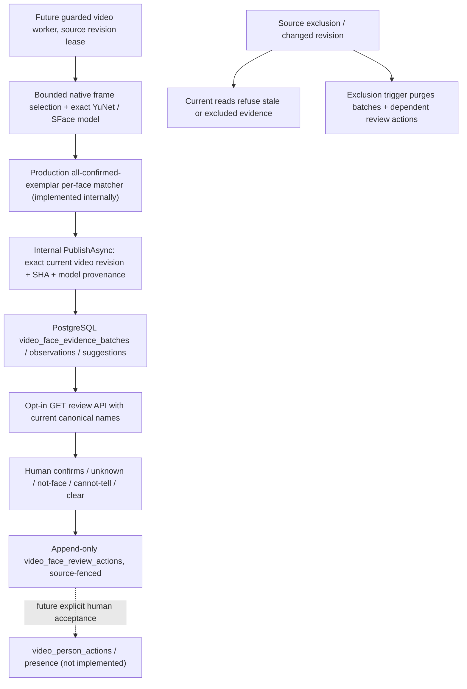

# WI-0155 production video-face review storage and admission

**Status:** PR #828 merged (schema v42); next PR adds production photo-scorer
parity and an internal video score-and-publish bridge. Neither PR enables
a video-face extraction worker or production recognition. Automatic identity
assignment is not authorized. The historical V06 package/CSV remains
private source-bound *experimental* review and is not imported into the
new tables by this PR.

## Data flow and authority



The publication endpoint is **not** exposed over HTTP. The existing bounded
repository contract accepts **geometry, timestamp and ranked person UUIDs**.
The new internal `PostgresVideoFaceMatchPublisher` accepts ephemeral 128D
SFace vectors, scores them through the photo scorer, and forwards only the
ranked leads and geometry to the revision-fenced repository. Neither path
accepts external paths, media uploads, model file paths, or source media. A future guarded worker must prove that
its frame extraction and embedding inputs are from an admitted current
video revision, and use production exemplar scoring before invoking it.

### PostgreSQL schema and invariant summary

- Version 42 creates `video_face_evidence_batches`,
  `video_face_observations`, `video_face_suggestions` and
  `video_face_review_actions`. Foreign keys ensure video-only
  revisions, canonical person records and transactional cascade
  deletion of derived observations.
- One immutable batch per video revision. A SHA-256 fingerprint of the
  exact evidence payload makes retries idempotent and rejects conflicting
  evidence instead of replacing already-reviewed face IDs. Model upgrades
  and intentional reruns require a separately designed versioned
  replacement/retention workflow; this PR does **not** overwrite history.
- The writer takes the source-row lock and validates the revision is
  latest, included, supported, local-folder and byte-digest matched.
  PostgreSQL coordinates exclusion FK locks with that source lock.
  Reads repeat the currentness/exclusion predicate.
- Individual observations have native frame dimensions, normalized
  face boxes, frame ordinal and timestamp. Person suggestions have
  ranked score and canonical person ID; live names are resolved at read
  time and merged people are marked non-selectable. No original video,
  aligned face crop, raw frame, embedding or local file path is stored.
- Human actions are append-only, identified by immutable observation
  UUID, revision and active canonical person; identical repeated
  actions do not append duplicates. `clear` reverses the current
  decision but keeps the audit trail. **Neither a human confirmation
  nor its score writes video-person presence or photo identity.**
- Source-exclusion insertion deletes the batch, which cascades to
  suggestions and review history. New revisions invalidate all
  current-evidence reads for older revisions even before cleanup.

### API routes (both disabled by default)

Enable only with both settings:

```text
PhotoIdentity:VideoLibraryEnabled=true
PhotoIdentity:VideoFaceReviewEnabled=true
```

GET `/api/videos/{revisionId}/face-review` returns only current
published evidence and current canonical person display names.
POST `/api/videos/{revisionId}/face-review/{observationId}/decision`
takes JSON `{"decision":"known","personId":"<canonical UUID>"}`.
Other decisions `unknown`, `not-face`, `cannot-tell` and `clear`
must omit `personId`. The POST returns `{"changed":true|false}`.
The endpoints provide no way to upload evidence or trigger inference.
The feature gate defaults to false. No UI is connected until a guarded
production publisher and private crop renderer have been implemented.

### Safe verification (PowerShell 7.6, disposable PostgreSQL only)

From the repository root on the PR branch:

```powershell
dotnet build src/PhotoIdentity.Persistence.Postgres/PhotoIdentity.Persistence.Postgres.csproj -c Release
dotnet build src/PhotoIdentity.Api/PhotoIdentity.Api.csproj -c Release
# Set ONLY to a disposable PostgreSQL administrator URL for test DB creation:
if (-not $env:PHOTOIDENTITY_TEST_POSTGRES_ADMIN_CONNECTION_STRING) {
    throw 'The isolated PostgreSQL test requires a disposable admin connection.'
}
dotnet test tests/PhotoIdentity.Integration.Tests/PhotoIdentity.Integration.Tests.csproj `
    -c Release --filter FullyQualifiedName~VideoFaceReviewProductionPersistenceTests
```

The test creates and drops its own uniquely named database. It seeds
synthetic video revisions and fake people (never originals/production
catalogue), verifies retry, conflicts, human undo, excluded source
cascade, stale revision and **zero** photo or video-person tagging.
If the admin connection environment variable is unset the test
**skips its body**, so a green test command alone does not prove DB
verification.

**Deployment caution:** an application started against the real
production catalogue will apply migration v42 during initialization
even though face-review routes and inference are disabled. Take and
verify a PostgreSQL backup and inspect the new schema and restoration
plan before deploying or testing this branch against production.
Do not enable the new feature or attempt to import experimental V06
JSON/CSV as production evidence. No new video processing settings or
worker activation is added in this PR.

## Next product integration slices

1. Guarded frame producer integrated into the existing video
   advancement/lease path, with bounds and native face pixel geometry.
2. **Implemented internally:** shared production best-of-all-exemplars
   per-face scoring, strict YuNet/SFace model identity and exact-match
   source-bound PostgreSQL publication. **Remaining:** guarded model inference,
   source-bound private crop access and explicit rights review.
3. Face-review UI backed by these APIs, current people and private
   revision-scoped crop evidence.
4. Explicit human-approved presence promotion to the existing
   `video_person_actions` audit system with deduplication, undo
   and stale-source protection.
5. Operational rights, retention, deletion and observed false-person
   risk acceptance before enabling any background recognition.

## 2026-11-19 — Production photo scorer parity and score-and-publish bridge

The new `PostgresIdentityMatchRegenerationScorer.RankVideoFaceVectorsAsync`
method loads the **identical confirmed-photo exemplar query** used by the
existing photo regeneration worker, in one `REPEATABLE READ, READ ONLY`
snapshot, and calls its **same** maximum-cosine-per-person scoring logic.
There is **no per-person exemplar cap**, group aggregation, exploratory
similarity threshold, automatic identity choice or identity assignment.
The response is a per-observation top-three ranked candidate list, with
canonical person UUIDs, deterministic score/UUID ordering, and full
128-dimensional vector validation. Missing model revisions or inconsistent
confirmed embeddings fail closed. No SFace vectors are persisted.

`PostgresVideoFaceMatchPublisher` turns a batch of bounded
`VideoFaceEmbeddingObservation` records into a v42
`VideoFaceEvidencePublication` using the actual production photo
scorer. The terminal repository checks the current supported unexcluded
video revision and source SHA-256 under the source-row lock *after*
scoring, so a changed source during a long inference cannot publish
stale matches; person merges invalidate conflicting rankings. The
result is an immutable batch with safe retry and zero video/person
assignment writes. The bridge is registered for internal DI only;
there is no route, CLI or scheduled call that invokes it.

**Scope still pending:** frame extraction, native face geometry detector,
aligned SFace embeddings from guarded video source, model file/license
approval, source-attested private crop display, and explicit human
presence promotion. The offline V06 aliases/CSV are not imported into
these production tables.

Run the new isolated PostgreSQL parity acceptance:

```powershell
Set-Location 'C:\Kod\codex\Photo Identity Indexer'
git fetch origin
git switch wi-0155-production-photo-scorer-parity
git pull --ff-only
if (-not $env:PHOTOIDENTITY_TEST_POSTGRES_ADMIN_CONNECTION_STRING) {
    throw 'Configure only a disposable PostgreSQL admin instance for this test.'
}
dotnet test .\tests\PhotoIdentity.Integration.Tests\PhotoIdentity.Integration.Tests.csproj `
    -c Release --filter 'FullyQualifiedName~VideoFaceProductionScorerParityTests'
if ($LASTEXITCODE -ne 0) { throw 'Production SFace scorer parity test failed.' }
```

The disposable test confirms that the fourth exemplar wins when the
first three do not match, that different faces have independent rankings,
the matching model is exact, idempotent publication preserves evidence,
a stale video revision is refused, and no person identity/tag table is
written. It uses only synthetic vectors and synthetic catalogue rows.

## 2026-11-20 — Native-resolution face producer foundation

**PR #831 is merged.** The existing photo matcher now supplies full
confirmed-exemplar rankings for production video observations.

The next isolated native path comprises:
- `VideoFaceNativeFrameProfile`: fixed FFmpeg arguments against an
  already SHA-verified **staged video copy**; frame timing is
  presentation-based, `-autorotate` is enabled, and **no scale, crop,
  pad, upsample or 640-pixel CLIP resize is performed**. JPEGs are
  capped at 12 MiB, decoded BGR24 frames at 3840 pixels per edge.
  Oversized native frames fail closed rather than being silently shrunk.
- `VideoFaceNativeFrameAnalyzer`: the same approved YuNet detector,
  5-point SFace aligner and SFace embedder used by the photo tooling.
  Enforces the exact pinned model digests, 128D vectors, at most
  32 detected faces per frame, native frame geometry and independent
  per-face embeddings; it returns **no person verdicts**.
- `VideoFaceNativeEvidenceProducer`: an **unregistered, explicit-call**
  producer requiring a hypothetical future `FaceEvidence` lease.
  It checks the existing PostgreSQL video control and photo priority,
  stages the current hash-verified local original without recalling
  online-only media, validates supported Rec.709 geometry and duration,
  loads pinned model manifests and validates their files, runs FFmpeg
  in a single-process Windows Job Object, heartbeats the lease, and
  rechecks permission before each frame. It processes 1–4 bounded
  frames and returns an ephemeral proposal with source SHA-256.
  Owned scratch media are cleaned up by the source and process
  supervisors. **No evidence database writes, job completion or
  identity assignments occur from this component.**

**Non-activation rule:** `FaceEvidence` already exists in the v34
queue enum and database constraint, but PR #833 did not add an
operator grant or worker connection for it. Merely deploying that
producer has no inference effect. PR #835 adds the separate selected
grant and lease-fenced commit, still without a CLI, runtime
registration, hosted worker or scheduler. A CLIP `FrameEvidence`
lease cannot authorize face inference. Native face crop rendering,
retention/deletion, model rights and persisted UI remain pending.

**Verification:** no originals, model files or production database are
needed for synthetic acceptance:
```powershell
git fetch origin
git switch wi-0155-native-face-frame-foundation
git pull --ff-only
dotnet test .\tests\PhotoIdentity.Integration.Tests\PhotoIdentity.Integration.Tests.csproj `
    -c Release --filter 'FullyQualifiedName~VideoFaceNativeFrameTests'
if ($LASTEXITCODE -ne 0) { throw 'Native face frame contract failed.' }
```
The test asserts no scaling, native geometry, independent observations,
model digest refusal and candidate overflow failure. Passing synthetic
tests is not evidence of real video detection quality or model rights.

## 2026-11-20 — Dedicated face lease, atomic receipt, and selected-job adapter

**Draft PR #835, migration v43.** `FaceEvidence` was already declared
by the original v34 queue/schema, but previously could not be granted
through `PostgresVideoScopedAttemptControl` and had no publication
transaction or coordinator receipt. This PR connects the existing
components without adding an automatic job scheduler:

1. `VideoFaceEvidenceLeaseIdentity` defines the exact dedicated kind,
   sampling policy, 1–4 frame native extraction preset and pinned
   YuNet/SFace model hashes. A CLIP `FrameEvidence` job cannot use
   the face adapter.
2. The selected-job grant accepts FaceEvidence **only** for the exact
   native preset, one named queued job, an approved FFmpeg SHA-256,
   an accepted frame count and a bounded authorization expiry. No
   generic enable switch authorizes face execution.
3. `VideoFaceEvidenceWorkerAdapter` is **not registered**. If called
   by a separately authorized future command, it monitors heartbeat
   and photo-first interruption through native production, complete
   all-exemplar scoring and the final database commit.
4. `TryPublishLeasedAsync` atomically checks the current unexcluded
   source and source SHA-256, selected control generation/expiry,
   matching live lease token, job identity/bytes/frame count, Rec.709
   inspection, cancellation and photo priority. If any final check
   fails, the batch and any attempted job-success mutation are both
   rolled back. `clock_timestamp()` catches leases/grants that
   expire *during* a longer transaction.
5. Migration **v43** adds nullable `publishing_job_id` to v42 batches.
   Earlier unleased batches retain NULL and **cannot** satisfy a
   different job's durable success receipt. The existing one-job
   coordinator now requires the face batch's exact job ID, current
   source and complete count before accepting a claimed success.
   No SFace vectors, raw frames or paths are stored in PostgreSQL.

**No production activation:** no FaceEvidence endpoint, CLI verb,
enqueue scan, automatic worker registration or background schedule
is provided by this PR. Deploying the code/schema alone cannot start
recognition or mark a person present. The existing video-face review
API stays off by default. The previous unleased internal publication
method remains for compatibility with prior tests and operator
experiments, but it does not produce a job-bound receipt.

**Migration caution:** unlike PR #831/#833, this PR changes the
schema from v42 to v43, and applications may initialize/migrate on
startup. Take and verify a fresh production PostgreSQL backup before
deploying any merged build, inspect migrations first, and keep
face recognition OFF. No V06 CSV import or real video inference
is required to test this PR.

**PowerShell 7.6 acceptance (disposable PostgreSQL ONLY):**
```powershell
Set-Location 'C:\Kod\codex\Photo Identity Indexer'
git fetch origin
git switch wi-0155-face-evidence-lease-fenced-publication
git pull --ff-only
if (-not $env:PHOTOIDENTITY_TEST_POSTGRES_ADMIN_CONNECTION_STRING) {
    throw 'Configure ONLY a disposable PostgreSQL admin instance (not production).'
}
dotnet test .\tests\PhotoIdentity.Integration.Tests\PhotoIdentity.Integration.Tests.csproj `
    -c Release --filter 'FullyQualifiedName~VideoFaceLeasedPublicationTests'
if ($LASTEXITCODE -ne 0) { throw 'FaceEvidence lease publication acceptance failed.' }
```
The test creates and drops its own synthetic database and uses fake
128D vectors instead of video files or ONNX inference. It exercises
selected scope, forged lease rejection, complete atomic publication,
job-specific current receipt and **zero** identity/person assignments.

Remaining pre-activation gates: implement an explicit one-video
operator command with local/rights and source/lease inspection,
review private native face-crop display and retention, connect the
persisted in-app human review, and require manual presence decisions.
