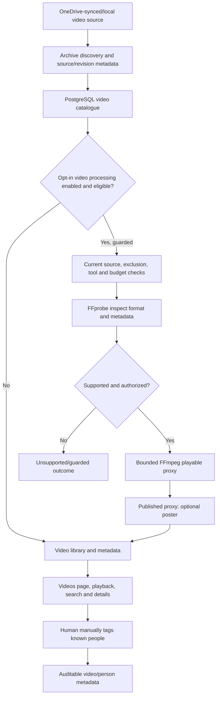
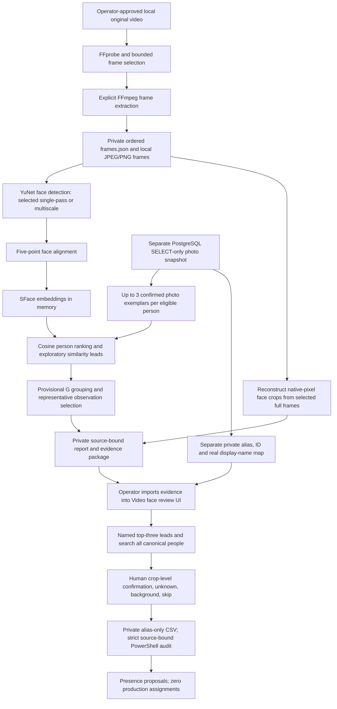
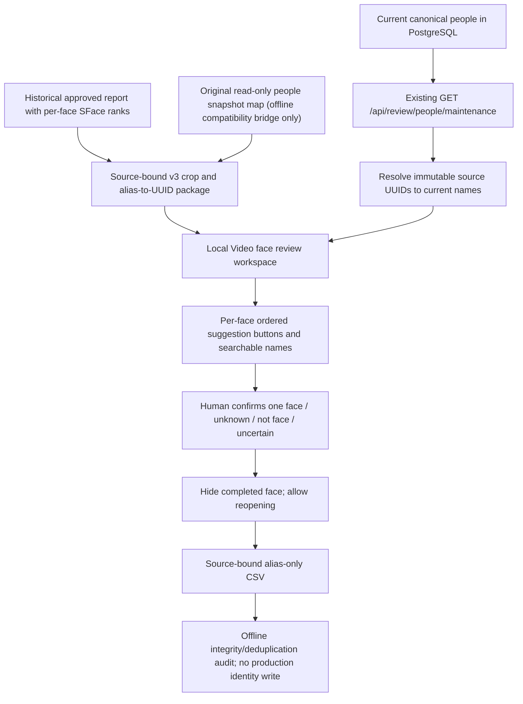
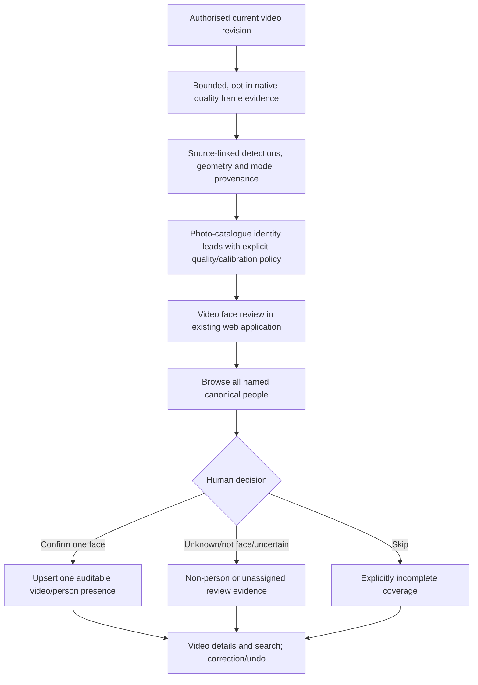

# Video to people: present architecture and production direction (WI-0155)

**Status:** descriptive architecture and intended direction, 2026-11-18. This
document distinguishes Photo Identity's **current production video ingestion**
from the **explicit, offline video-face feasibility evaluation** and the
**future product design**. Arrows between these paths do not exist in the
production application. Nothing here authorizes new original reads, model
execution, identity writes, hydration, jobs or retention changes.

## 1. Production video ingestion today — no automatic face recognition

The registered video archive worker processes at most one video in the
archive-advancement cycle when opted in and source/budget checks pass.
Posters/proxies are playback derivatives, **not** frames used for face
recognition. Manual video/person tagging already exists on video details
and uses the application's canonical people catalogue. There is **no**
production video-face detector, automatic video identity ranking job or
write-back from WI-0155.

## 2. Current bounded, offline video-face experiment — no production writes

The separate private people map is created during the same read-only
snapshot as the face exemplar ranking. The in-app reviewer receives names
**only** through an explicit local import and verifies the map's snapshot
against the source-bound evidence package. The UI never sends the face
package, map or CSV to the API; no video/person association is stored.

The operator chooses previously approved video frames. The extraction
script constrains source dimensions to 3840 × 3840 or less and applies a
maximum-edge 3840, aspect-preserving FFmpeg scale (which does not enlarge
smaller frames), followed by JPEG quality 3. That JPEG stage is **lossy**;
it is not a native lossless frame. Actual original codec/frame dimensions,
scene composition, focus, motion and compression bound the usable face
detail. The reviewed crop is cut from the existing extracted frame with
about 25% bounding-box margin; `CropLongEdge=512` is an **upper bound**,
not a target: small crops are **not upscaled**. Browser review likewise
preserves native crop display size and labels its pixel dimensions. The
versioned bundle also records the **actual already-extracted frame width
and height and the detector's raw face box width and height in pixels**.
These values are measured directly during crop reconstruction before
margin or scaling; no original video or model is reopened. Comparing them
shows whether a small face is caused by a small source frame, small
subject footprint within a large frame, or both.

The experimental mode is not exactly the still-photo pipeline:

| Concern | Production photo recognition | WI-0155 offline video experiment |
| --- | --- | --- |
| Decoder/input | Original still-photo image or approved portable image | Operator-extracted video frame JPEG/PNG |
| Detection | Production YuNet adapter, default single-pass | Same YuNet implementation; configurable multi-scale tiles and threshold |
| Alignment/embedding | OpenCV five-point + model-pinned SFace | Same alignment implementation and model-pinned SFace |
| Candidate reference | Photo review/indexer suggestion pipeline | Snapshot of eligible *confirmed still-photo* SFace embeddings, max 3 independent photos per person |
| Candidate policy | Production persisted/audited suggestion and review contracts | Exploratory cosine ranks, group top-three leads; no calibrated video acceptance threshold |
| Identity persistence | Audited photo face-person review actions | Alias-only offline CSV proposals; zero API/DB writes |

SFace's **112 × 112 aligned model input** is an intrinsic model protocol
and may resample a low-resolution face; it does not recover source detail.
YuNet detection confidence is not an identity-confidence probability.
A video can contain many people far apart in a 1000 × 1000 frame, producing
small face regions even from a high-quality frame. Processing **more**
independent, genuinely clearer source frames can supply better evidence;
simply enlarging the same crop cannot.

### V06 evidence-quality gate, 2026-11-18

The maintainer measured the **53 existing V06 review PNG crops** (not
the unknown source video frame dimensions): long-edge minimum 24 px,
maximum 102 px, mean 39.45 px; **49/53 are below 64 px** and all
53 are below 112 px. This is evidence of insufficient review detail
for most crops; it does not establish whether a higher-quality frame
of the same person exists elsewhere in the clips.

No automatic upscaling, browser zoom, hallucinated detail or forced
re-identification is approved as a fix. A future, separately reviewed
experiment should compare **native source frame dimensions, face bounding
box in pixels and image quality across adjacent/native video frames**,
then select a better genuine observation where available. Compare
human-recognition value and ranking quality without silently modifying
the original model protocol or requiring repeated detections of a
person who is already credibly confirmed.

## 2a. Product-facing reviewer transition (PR #827, draft)

The diagram in §2 describes the **legacy v2** read-only gallery:
it imported a separate name map into browser memory and showed
group-averaged advisory rankings. PR #827 replaces that workflow
for new **v3** packages:

This supports real people names and normal review UX without a
second in-browser people-file import. It is **not** yet a complete
production video-person association workflow: the V06 report still
requires explicitly generated local evidence, the historical alias
bridge exists only for snapshot compatibility and decisions are
still private CSV proposals. New canonical people not present in
that snapshot are displayed from the database but cannot be
assigned an invented old alias.

**SFace parity finding:** the model code and five-point alignment
match production, but the experiment's max-three-distinct-photo
reference set and possible group averaging are **not** production
scorer parity. The v3 UI uses the report's existing **per-face**
rankings so a group suggestion is never misrepresented as
this specific face's score. This does not recompute ranks
against all production exemplars or repair low-resolution
input evidence. The subsequent production integration must
benchmark exact reference-set and sampling decisions against
human-corroborated video people using false-positive risk,
not top-1 score alone.

## 3. Desired production direction — not implemented

This is **not** an endorsement of automatically assigning identities.
Before admission to production it requires an operator-approved processing
policy, native-quality evidence and coverage limits, source/revision
binding, security and privacy controls, retention/deletion,
correction/undo, rights/licensing checks, measured wrong-person risk
and provenance. The human review UI should remain present-first:
one credible confirmed face can establish presence, duplicate
observations do not create duplicate people, and unreviewed groups
never mean someone was absent.

## Key implementation references

- `src/PhotoIdentity.Api/VideoArchiveProcessingService.cs` — guarded
  opt-in video inspection and proxy/poster processing
- `src/PhotoIdentity.Web/Pages/VideoDetails.razor` — manual people tagging
- `tools/PhotoIdentity.VideoFaceFeasibility/New-VideoFaceCoverageFrames.ps1`
  — FFprobe/FFmpeg frame extraction and bounds
- `tools/PhotoIdentity.VideoFaceFeasibility/VideoFaceExperiment.cs`
  and `VideoFaceCatalogueRunner.cs` — offline detection and ranking
- `tools/PhotoIdentity.VideoFaceFeasibility/VideoFaceCatalogueEvidenceReader.cs`
  — read-only still-photo snapshot and private canonical alias map
- `tools/PhotoIdentity.VideoFaceFeasibility/New-VideoFaceGroupReview.ps1`
  — source-pixel review crop construction
- `src/PhotoIdentity.Web/Pages/VideoFaceReview.razor` and
  `wwwroot/js/video-face-review.js` — local interactive review
